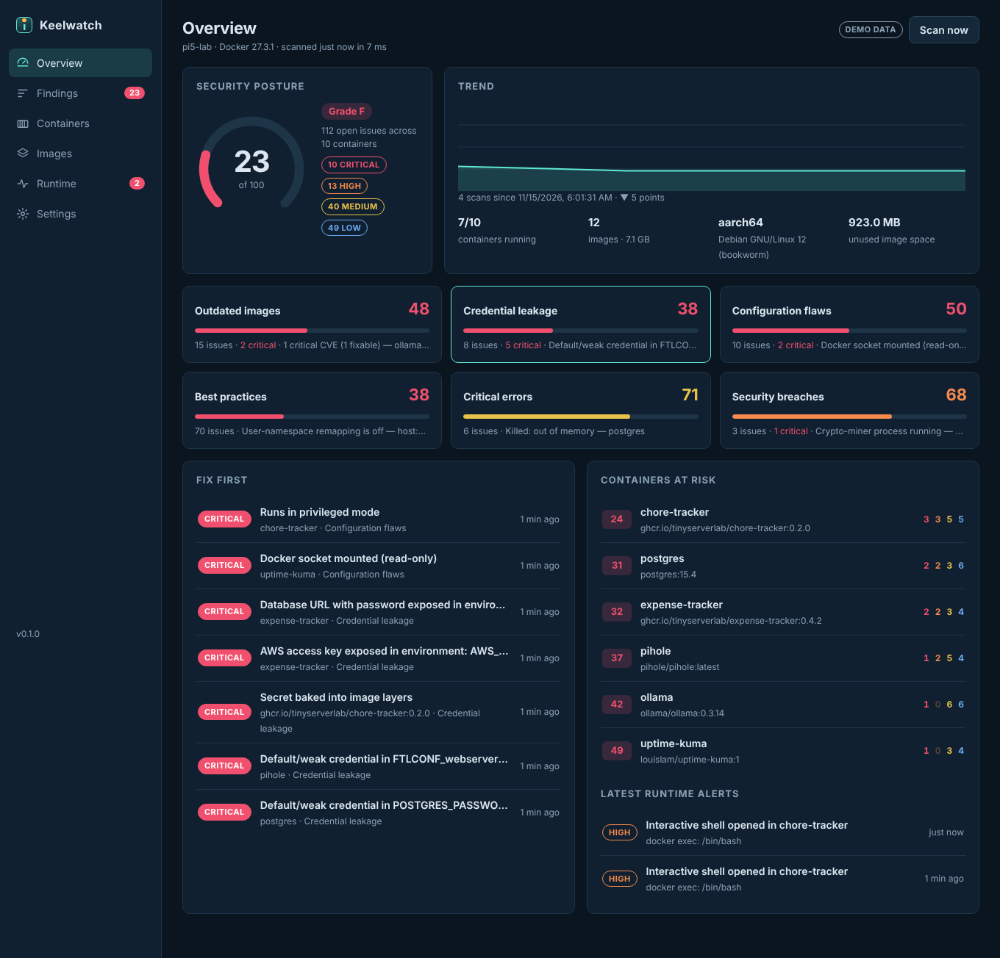
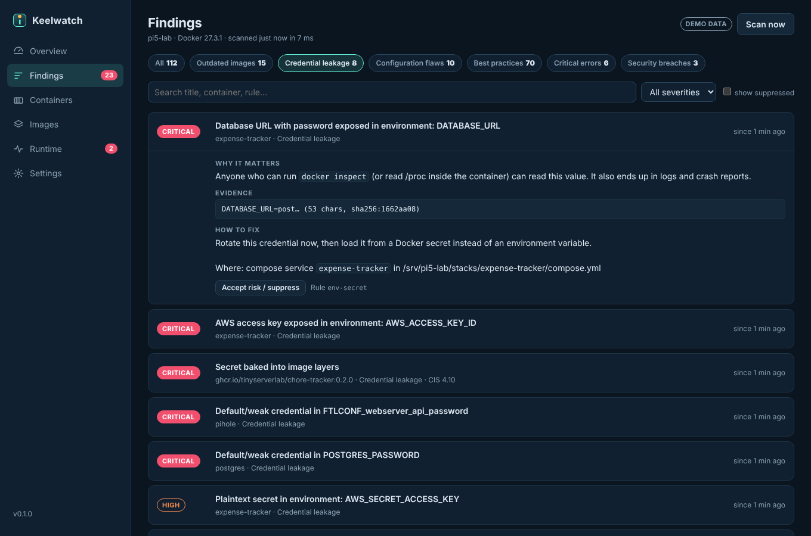
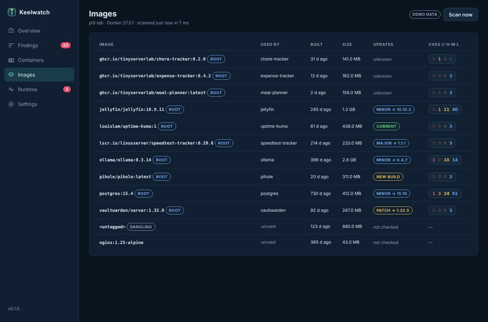

# Keelwatch

**Self-hosted Docker security posture dashboard.** One small container that tells you, in plain language, what is wrong with the Docker host you already run. It covers outdated images, leaked credentials, risky configuration, missing best practices, crashing containers, and signs of a breach. Every finding comes with the exact fix for your compose file.

Built for homelabs, Raspberry Pi servers and small VPS fleets running plain Docker / Docker Compose (no Kubernetes required).



## What it checks

| Area | What Keelwatch looks for | How |
|---|---|---|
| **Outdated images** | Newer build pushed for the same tag, newer patch/minor/major version, images older than 6–12 months, known CVEs (critical/high, fixable), out-of-support Docker Engine | OCI registry API (anonymous token flow, semver tag compare), bundled **Trivy** |
| **Credential leakage** | AWS/GitHub/GitLab/Stripe/Slack/OpenAI/Anthropic/Google keys, DB URLs with passwords, private keys, JWTs and plaintext `*_PASSWORD/SECRET/TOKEN/KEY` in container env; default passwords (`changeme`, `postgres`…); secrets baked into image layers; host `~/.ssh`, `~/.aws`, `~/.docker/config.json` mounted; secrets hard-coded in compose files; world-readable or non-git-ignored `.env` files | `docker inspect`, Trivy secret scanner, read-only compose folder scan. **Values are always redacted** (prefix + length + short hash) |
| **Configuration flaws** | `privileged`, dangerous capabilities (SYS_ADMIN, NET_ADMIN, ALL…), host network/PID/IPC/userns, Docker socket mounts, sensitive host paths (`/`, `/etc`, `/proc`…), seccomp/AppArmor disabled, host devices, ports published on `0.0.0.0` (bypasses UFW), Docker API on TCP without TLS, insecure registries | Container + daemon inspection, `daemon.json` |
| **Best practices** | Runs as root, no `no-new-privileges`, writable root FS, no memory/CPU/PIDs limits, no health check, `:latest` tags, unrotated logs, no restart policy, userns-remap off, ICC on default bridge, live-restore off, no AppArmor | CIS Docker Benchmark–mapped rules (CIS IDs shown on findings) |
| **Critical errors** | Restart loops, OOM kills, non-zero exits for services that should be running, failing health checks, dead containers, engine warnings, CPU/memory saturation, reclaimable disk (dangling images, build cache) | Inspect state, `docker stats`, `docker system df`, live event stream |
| **Security breaches** | Crypto-miners (xmrig, kinsing, `stratum+tcp://`…), reverse shells, `curl … \| sh`, offensive tools, **process drift** from a learned baseline, interactive `docker exec` shells, OOM/crash/unhealthy events; optional kernel-level detection via **Falco** | Docker events stream, periodic `docker top`, Falcosidekick webhook |

Everything rolls up into a **0–100 posture score** per host, per category and per container, with a trend line. Any open critical caps the host score at 69 (grade D).

**Security debt** tracks how long issues stay unfixed. Each finding gets a fix-by date counted from when it was first seen (critical 7 days, high 30, medium 90, low 180). The Overview shows overdue counts, an age breakdown and an overdue trend, and **Findings → overdue only** lists what is past due.

**Network map:** the **Network** page draws who can reach each container (the network, localhost only, the host network stack, the Docker daemon) and which networks connect them. It calls out risky paths, such as an exposed container that also joins an internal database network. Click any box to trace its connections.

**Multiple hosts:** run Keelwatch as an agent on each extra Docker host and see the whole fleet on one dashboard (see [Multiple hosts](#multiple-hosts)).

| Findings with fixes | Images, updates and CVEs |
|---|---|
|  |  |

## Quick start

```bash
git clone https://github.com/<you>/keelwatch && cd keelwatch
openssl rand -base64 24 > keelwatch_password.txt
sudo chown 65532:65532 keelwatch_password.txt && sudo chmod 400 keelwatch_password.txt
docker compose up -d --build
```

Open **http://127.0.0.1:8090** and sign in with the password in `keelwatch_password.txt`. The first scan runs immediately, and CVE results fill in over the next few minutes while Trivy downloads its database.

> No password file? Keelwatch generates one on first start and prints it **once** in `docker logs keelwatch`.

Edit the `- ./:/compose:ro` line in `docker-compose.yml` to point at the folder holding your stacks (for example `/srv/pi5-lab/stacks:/compose:ro`) so compose and `.env` files are audited too.

### Try it without touching your host

```bash
docker run --rm -p 127.0.0.1:8090:8080 -e KEELWATCH_DEMO=1 keelwatch:local
# or: go run ./cmd/keelwatch   with KEELWATCH_DEMO=1
```

Demo mode simulates a Raspberry Pi homelab with a realistic set of mistakes (a compromised container running a miner, leaked AWS keys, a restart loop, an OOM-killed database…). The demo password is printed in the log.

## How it's secured

Keelwatch is a security tool with read access to your Docker API. It's designed so that access can't be turned against you:

- **Read-only by construction.** The client only issues `GET` requests, and the default compose puts it behind [`docker-socket-proxy`](https://github.com/Tecnativa/docker-socket-proxy) with `POST=0`, `EXEC=0` on an `internal: true` network. Keelwatch could not start, stop or exec into a container even if compromised.
- **Distroless, non-root, read-only.** Static Go binary on `distroless/static:nonroot` (UID 65532), `read_only: true`, `cap_drop: ALL`, `no-new-privileges`, memory/CPU/PID limits. Keelwatch audits itself and scores well.
- **No third-party Go dependencies.** Standard library only, so there is no transitive supply chain to compromise.
- **Secrets never stored or shown.** Leaked values are redacted before they reach the database, API or notifications. Keelwatch's own secrets support `*_FILE` (Docker secrets).
- **Pinned scanner.** Trivy is pinned by version in the Dockerfile (pin by digest for production). CI builds signed multi-arch images with SBOM and provenance.
- **Web hardening.** PBKDF2-SHA256 password hashing, HMAC-signed `HttpOnly` + `SameSite=Strict` session cookie, CSRF header on every state change, login rate limiting, strict CSP. Bind to `127.0.0.1` and publish through Cloudflare Tunnel / a reverse proxy.

## Configuration

All settings are environment variables. Any secret can also be given as `NAME_FILE=/run/secrets/...`.

| Variable | Default | Purpose |
|---|---|---|
| `DOCKER_HOST` | `unix:///var/run/docker.sock` | Docker API (use `tcp://socket-proxy:2375` with the proxy) |
| `KEELWATCH_PASSWORD` | generated | Admin password |
| `KEELWATCH_AUTH` | `on` | `off` only behind an authenticating proxy (e.g. Cloudflare Access) |
| `KEELWATCH_ADDR` | `:8080` | Listen address |
| `KEELWATCH_DATA` | `/data` | State file + Trivy cache |
| `KEELWATCH_SCAN_INTERVAL` | `30m` | Full scan interval (container start/stop/OOM events also trigger a rescan) |
| `KEELWATCH_CHECK_UPDATES` | `true` | Query registries for newer images |
| `KEELWATCH_REGISTRY_TTL` | `6h` | Cache registry results (friendly to Docker Hub limits) |
| `KEELWATCH_TRIVY` | `trivy` | Trivy binary, or `off` |
| `KEELWATCH_CVE_TTL` | `24h` | Re-scan images for CVEs this often |
| `KEELWATCH_COMPOSE_DIRS` | — | Comma-separated folders (mounted `:ro`) to audit for compose/.env secrets |
| `KEELWATCH_DAEMON_JSON` | `/host/etc/docker/daemon.json` | Mounted daemon.json to audit |
| `KEELWATCH_NOTIFY_MIN_SEVERITY` | `high` | `critical` · `high` · `medium` · `low` |
| `KEELWATCH_NTFY_URL` / `_NTFY_TOKEN` | — | ntfy topic URL |
| `KEELWATCH_DISCORD_WEBHOOK` | — | Discord webhook |
| `KEELWATCH_SLACK_WEBHOOK` | — | Slack incoming webhook |
| `KEELWATCH_TELEGRAM_TOKEN` + `_TELEGRAM_CHAT_ID` | — | Telegram bot |
| `KEELWATCH_WEBHOOK_URL` | — | Generic JSON POST |
| `KEELWATCH_BASE_URL` | — | Link included in notifications |
| `KEELWATCH_BASE_PATH` | — | Serve under a sub-path, e.g. `/keelwatch` for `https://apps.example.com/keelwatch` |
| `KEELWATCH_FALCO_TOKEN` | — | Enables `POST /api/falco` for Falcosidekick |
| `KEELWATCH_DEMO` | `false` | Simulated host |
| `KEELWATCH_AGENT_TOKENS` | — | Hub: allowed agents as `name=token` pairs (comma or newline separated) |
| `KEELWATCH_HUB_URL` + `KEELWATCH_HUB_TOKEN` | — | Agent: dashboard to push results to, and this host's token |

### Serving under a sub-path

A subdomain such as `keelwatch.example.com` needs no extra settings. To serve under a path instead, e.g. `https://apps.example.com/keelwatch`, set `KEELWATCH_BASE_PATH=/keelwatch`. It works whether your reverse proxy keeps the `/keelwatch` prefix or strips it.

### Multiple hosts

One Keelwatch is the **hub**: it scans its own host and hosts the dashboard. Every other Docker host runs the same image as an **agent**. The agent scans locally (all checks, including compose files, `daemon.json`, Trivy and runtime events) and pushes its results to the hub over HTTPS after each scan. Agents only make outbound connections, so no Docker API is exposed on the network and agents behind NAT work.

1. Create a token per agent: `openssl rand -hex 24`.
2. On the hub, list the agents (a Docker secret works well):
   ```yaml
   KEELWATCH_AGENT_TOKENS_FILE: /run/secrets/agent_tokens   # file lines: pi-b=<token>
   ```
3. On each agent host, use the normal compose file, then add these settings and delete the `ports:` line:
   ```yaml
   KEELWATCH_HUB_URL: https://keelwatch.example.com          # include any base path
   KEELWATCH_HUB_TOKEN_FILE: /run/secrets/hub_token
   ```

Pick a host in the drop-down at the top of the dashboard, or click it in the **Fleet** table on the Overview. The token decides which host a report belongs to, so an agent can't post as another host. Suppressions and alert acknowledgements made on the hub are sent back to the agent with the reply to its next push. To retire a host, click ✕ in the Fleet table (or **Settings → Remove this host**). Its data is deleted and its agent's reports are refused until you restore it under **Settings → Removed hosts**. To revoke the agent for good, also delete its line from `KEELWATCH_AGENT_TOKENS`. Remote hosts scan on their agent's schedule. **Scan now** applies only to the hub, and a host that misses two scan intervals is marked *stale*. If the hub is behind Cloudflare Access, add a bypass (or service token) for `/api/agent/report`, the same way as for `/api/falco`.

### Falco (optional, kernel-level runtime detection)

Built-in runtime detection samples processes and watches Docker events. For syscall-level detection run Falco with Falcosidekick and add:

```yaml
WEBHOOK_ADDRESS: http://keelwatch:8080/api/falco
WEBHOOK_CUSTOMHEADERS: "Authorization:Bearer <KEELWATCH_FALCO_TOKEN>"
```

Falco events appear on the **Runtime** page and count against the score until acknowledged.

### CLI / CI mode

```bash
keelwatch scan                    # human-readable report
keelwatch scan --json > report.json
keelwatch scan --fail-on critical # exit code 3 if any critical finding exists
```

## Using it day to day

- **Suppress** a finding you have consciously accepted (e.g. Pi-hole needs `network_mode: host`). It stays listed under Settings with your note and stops counting against the score.
- **Acknowledge** runtime alerts once explained, for example the `docker exec` you just ran yourself.
- **Export** the latest report as JSON from Settings.
- **Pay down debt:** start with **Findings → overdue only**. Suppressing a finding (accepted risk) also takes it out of the debt count.

## Development

```bash
go test ./...                       # unit + end-to-end tests (demo Docker API)
KEELWATCH_DEMO=1 KEELWATCH_DATA=/tmp/kw go run ./cmd/keelwatch
KEELWATCH_LIVE=1 go test ./internal/registry -run Live -v   # hits real registries
docker buildx build --platform linux/amd64,linux/arm64 -t keelwatch .
```

Layout: `internal/docker` (read-only Engine API client) · `internal/scan` (rules, secrets, runtime, CVE, scoring) · `internal/registry` (update checks) · `internal/engine` (scheduler, event watcher, CVE queue) · `internal/server` (API, auth, embedded UI) · `internal/demo` (simulated host).

## Known limits

- Update checks work for public images. Private registries currently show "unknown".
- Process checks are sampled each scan (default 30 min), so a short-lived process can be missed. Use Falco for continuous detection.
- CIS coverage is the automatable subset of the Docker Benchmark. Host-level items (partitions, auditd rules) are not checked yet.
- Single host per instance. Multi-host agents are on the roadmap.

## Roadmap

Multi-host agents and fleet view · private-registry credentials · CIS host checks · scheduled PDF reports · optional local-AI explanations via Ollama · hosted edition for MSPs.

## License

AGPL-3.0 (add the `LICENSE` file before publishing).
